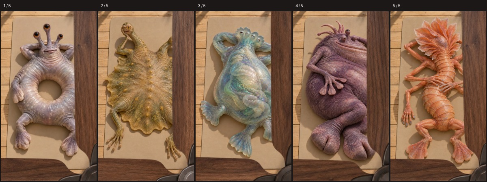

# מעבר מאוורר בין תמונות — ערכה ל־Codex

**הפכו חמש תמונות לסרטון שבו כל סיבוב של להב חושף בהדרגה את הסצנה הבאה.**

ערכה מאת **ליאור שוברט (Lior Shubert), יוצר AI והבעלים של סטודיו אלקטריק פומה**, עם פרומפט בעברית, גרסת סקיל, מאוורר שקוף, חמש תמונות חייזרים וחמישה אפקטים קוליים תואמים.

[לאתר סטודיו אלקטריק פומה](https://theelectricpuma.com/)

## מה מקבלים?

- שש תמונות: מאוורר שקוף אחד וחמש תמונות חייזרים ממוספרות.
- חמישה קובצי MP3, אחד לכל חייזר.
- [פרומפט בעברית להדבקה](PROMPT-HE.txt), עם גאומטריה ותזמון של המעבר.
- [גרסת SKILL.md](SKILL.md) לשימוש כסקיל, עם [הוראות ביצוע](references/workflow-he.md).
- [סרטון הדגמה קיים](examples/fan-transition-demo.mp4) שממחיש את המעבר. חמשת קולות החייזרים מצורפים בנפרד, ואינם משולבים בהדגמה הזאת.

## איך משתמשים?

1. מורידים את תיקיית הערכה למחשב ומחלצים אותה אם היא בקובץ ZIP.
2. נותנים ל־Codex גישה לתיקייה.
3. מעתיקים לצ׳אט את התוכן של `PROMPT-HE.txt`.
4. Codex בודק את הכלים ואת עלות הפקת האנימציות ומבקש אישור להוצאה.
5. לאחר ההפקה מקבלים MP4, גרסה שקטה ופרויקט מקור.

**הכלים הנדרשים:** הפרומפט נכתב לעבודה עם Kling דרך Higgsfield ועם HyperFrames להרכבה ולייצוא. הכלים והגישה לשירותים אינם חלק מההורדה; התקנת Codex לבדה אינה מספיקה. הפקת האנימציות עשויה להיות בתשלום אצל הספק, ויש לבדוק מחיר וזמינות בזמן השימוש.

## התוצאה המתוכננת

סרטון אנכי 9:16, באורך 8 שניות, 720×1280 וב־24 פריימים לשנייה. חמש הסצנות זזות בעדינות; המצלמה קבועה. מאוורר שקוף מסתובב בחזית, וקו החלפת הסצנות מוסתר מאחורי הלהב.

הפרומפט מעביר את האנימציה של הדמויות למודל הווידאו ואת המאוורר והמעברים להרכבה מדויקת בקוד. שמרו על קובץ המאוורר המלא ועל המידות בהוראות כדי לשחזר את הגאומטריה שנבדקה.

## תמונות וקולות

| מספר | תמונה | אפקט קולי |
| --- | --- | --- |
| 01 | חייזר טבעתי | `assets/sfx/01-ring-organism.mp3` |
| 02 | חייזר דו־ראשי | `assets/sfx/02-split-head-pancake.mp3` |
| 03 | חייזר שקוף | `assets/sfx/03-transparent-bell.mp3` |
| 04 | חייזר סגול פרוותי | `assets/sfx/04-purple-walking-pillow.mp3` |
| 05 | חייזר כתום | `assets/sfx/05-coral-many-armed.mp3` |

קובצי התמונות נמצאים ב־`assets/images` עם אותו מספור. אפשר להשתמש בחמש תמונות אחרות, בסדר 01–05; החלפת הדמויות מחייבת גם לבחור קולות שמתאימים לתוכן החדש. תמונת המאוורר נשארת קבועה.

## על היוצר

נוצר על ידי **ליאור שוברט (Lior Shubert), יוצר AI והבעלים של סטודיו אלקטריק פומה (Electric Puma)**. דוגמאות נוספות ועבודות באתר: [theelectricpuma.com](https://theelectricpuma.com/).

## English overview

Created by **Lior Shubert**, AI creator and owner of **Electric Puma studio** — [theelectricpuma.com](https://theelectricpuma.com/).

A Hebrew-first Codex skill and prompt kit for a clockwise ceiling-fan blade wipe between five animated scenes. Includes a transparent rotor, five alien reference images, five matching sound effects, and a visual demo. Targets an 8-second vertical video. Requires an image-to-video service (the documented workflow uses Kling via Higgsfield) and HyperFrames for deterministic assembly and export.
